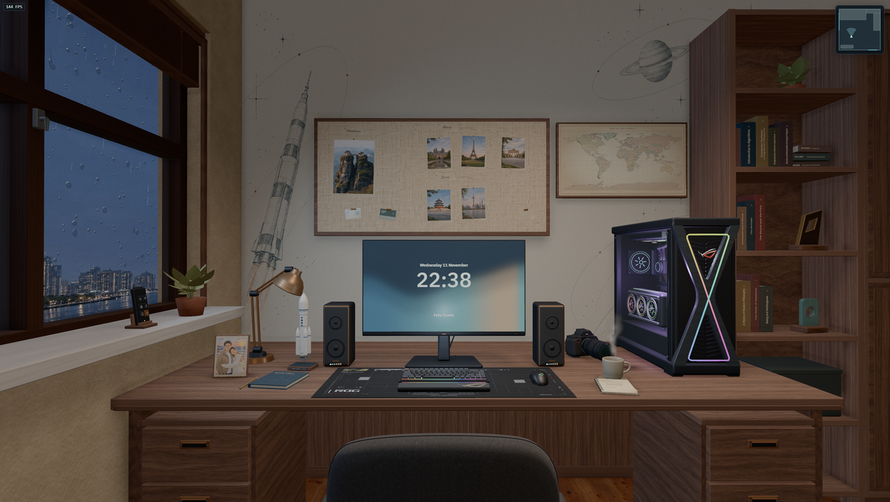

# Felix Studio

**English** · [简体中文](README.zh-CN.md)

[](https://felixpy.com/)
[](https://github.com/felixpy/felixpy.com/actions/workflows/ci.yml)
[](LICENSE)
[](https://nodejs.org/)
[](https://threejs.org/)

Felix Yang’s personal site, built around an interactive 3D studio. The room runs in the browser with React, Three.js, and React Three Fiber. Phones and other compact screens open the personal profile directly.



## Explore the studio

- Look around the room, inspect objects, or switch to the workbench and window viewpoints.
- Use the window remote to switch between Shanghai and New York, change weather and daylight, or adjust the blinds.
- Open the computer to read the profile, play music from the playlist, or play Orbital Patrol.

On desktop, drag or use the arrow keys to look around, and scroll to zoom. Click an object or press **E** to interact. Press **Esc** to put an object back or return to the previous view.

## Run locally

Use Node.js 24 or later.

```sh
npm ci
npm run dev
```

Open the URL printed by Vite. The 3D room requires WebGL 2. If WebGL is unavailable, the desktop app opens without the room. Studio preferences are stored in the browser.

## Build and test

```sh
npm run build
npx playwright install chrome
npm test
```

The build checks TypeScript and writes the static site to `dist/`. Run `npm run preview` to inspect the production build locally. Playwright uses Chrome with software WebGL. On Linux, use `npx playwright install --with-deps chrome` if system libraries are missing.

## Deploy

Run `npm ci` and `npm run build` from the repository root, then publish `dist/` with a static host. The site requires no server process or build-time secrets. Live weather is fetched from Open-Meteo in the browser.

## Project layout

| Path              | Responsibility                                                  |
| ----------------- | --------------------------------------------------------------- |
| `src/app/`        | Site entry, loading UI, browser preferences, and live weather   |
| `src/content/`    | Profile, travel copy, and bilingual content                     |
| `src/desktop/`    | Computer shell, profile, music library and playback, and arcade |
| `src/scene/`      | Room geometry, materials, lighting, cameras, and interactions   |
| `src/spectral/`   | Spectral styles, shared shader renderer, and fragment shaders   |
| `public/media/`   | Runtime media grouped by use                                    |
| `scripts/assets/` | Optional font, map, and depth-map build tools                   |
| `tests/`          | Model and browser regression checks                             |

## Contribute

Read the [contributing guide](CONTRIBUTING.md) and [code of conduct](CODE_OF_CONDUCT.md) before opening a pull request. Use [GitHub Issues](https://github.com/felixpy/felixpy.com/issues/new/choose) to report a bug or propose a change. [AGENTS.md](AGENTS.md) documents repository conventions.

## License and media

Project code is covered by the [MIT license](LICENSE). Third-party media and components carry their respective terms. See [Media](docs/media.md) for sources, licenses, and asset build commands.
