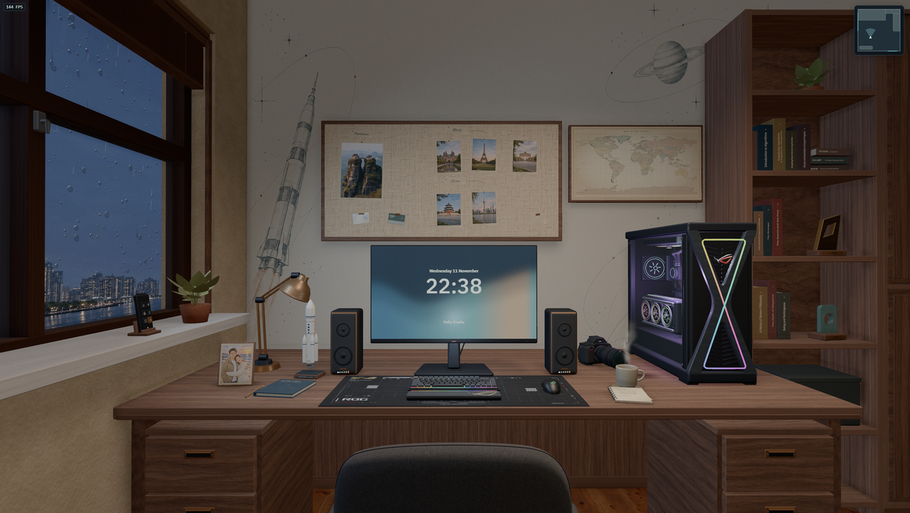

# Felix Studio

[English](README.md) · **简体中文**

[](https://felixpy.com/)
[](https://github.com/felixpy/felixpy.com/actions/workflows/ci.yml)
[](LICENSE)
[](https://nodejs.org/)
[](https://threejs.org/)

Felix Yang 的个人网站，以互动 3D 工作室为主。房间使用 React、Three.js 和 React Three Fiber 在浏览器中渲染。手机等窄屏设备会直接打开个人主页。



## 探索工作室

- 环顾房间、检视物件，或切换到工作台和窗前视角。
- 用窗台遥控器在上海和纽约之间切换，调整天气、昼夜和百叶窗。
- 打开电脑查看个人主页、从歌单播放音乐，或玩 Orbital Patrol。

桌面端可拖动鼠标或按方向键环顾，用滚轮缩放。点击物件或按 **E** 交互，按 **Esc** 放回物件或返回。

## 本地运行

需要 Node.js 24 或更新版本。

```sh
npm ci
npm run dev
```

打开 Vite 输出的地址。3D 房间需要 WebGL 2。WebGL 不可用时，桌面端直接打开电脑界面。工作室偏好保存在当前浏览器中。

## 构建与测试

```sh
npm run build
npx playwright install chrome
npm test
```

构建会先检查 TypeScript，然后生成可静态托管的 `dist/`。用 `npm run preview` 查看构建产物。Playwright 使用 Chrome 和软件 WebGL。Linux 环境可用 `npx playwright install --with-deps chrome` 安装浏览器及系统依赖。

## 部署

在仓库根目录执行 `npm ci` 和 `npm run build`，然后把 `dist/` 发布到静态托管平台。站点无需运行服务端进程，也无需构建密钥。实时天气由浏览器向 Open-Meteo 获取。

## 目录

| 路径              | 职责                                          |
| ----------------- | --------------------------------------------- |
| `src/app/`        | 网站入口、加载界面、浏览器偏好和实时天气      |
| `src/content/`    | 个人资料、旅行说明和双语内容                  |
| `src/desktop/`    | 屏内桌面、个人页、音乐库和播放逻辑、街机游戏  |
| `src/scene/`      | 房间建模、材质、灯光、机位和交互              |
| `src/spectral/`   | Spectral 样式、共用 Shader 渲染器和片元着色器 |
| `public/media/`   | 按用途归类的网站运行素材                      |
| `scripts/assets/` | 字体、地图和深度图的可选构建工具              |
| `tests/`          | 模型和浏览器回归测试                          |

## 参与贡献

提交拉取请求前，请阅读[贡献指南](CONTRIBUTING.md)和[社区行为准则](CODE_OF_CONDUCT.md)。可以在 [GitHub Issues](https://github.com/felixpy/felixpy.com/issues/new/choose) 报告问题或提出改进建议。仓库约定见 [AGENTS.md](AGENTS.md)。

## 许可证与素材

项目代码采用 [MIT 授权](LICENSE)。第三方素材和组件适用各自的授权条款。素材出处、授权和生成命令见[素材说明](docs/media.md)。
